# Nipuna LMS — Product guide

How the product works, as flowcharts. Each chart has a line or two of explanation; the details live in the other docs
(see [Where to go next](#13-where-to-go-next)). The charts are [Mermaid](https://mermaid.js.org/) and draw on GitHub and in
VS Code's Markdown preview.

**Contents:** [1 Big picture](#1-the-big-picture) · [2 Roles](#2-who-uses-it) · [3 Admission to first class](#3-from-admission-to-first-class) ·
[4 Enrolment status](#4-the-life-of-an-enrolment) · [5 Batches](#5-setting-up-a-batch) · [6 Class day](#6-a-class-day) ·
[7 Attendance](#7-attendance) · [8 Content and access](#8-content-recordings-and-how-long-a-student-can-use-them) ·
[9 Work and tests](#9-assignments-and-tests) · [10 Results](#10-results) · [11 Certificates](#11-completion-and-certificates) ·
[12 Who decides](#12-who-decides-what) · [13 Next](#13-where-to-go-next)

---

## 1. The big picture

The CRM owns admissions and money. The LMS owns learning. The CRM tells the LMS about each admission; the LMS tells the CRM
how the student is doing.

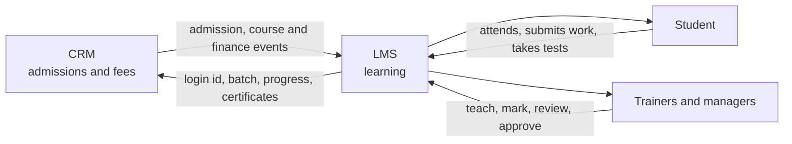

The LMS never edits money. It only shows a read-only summary of what the CRM sends.

---

## 2. Who uses it

Each login has exactly one role. A Branch Manager sees only the branch chosen at sign-in.

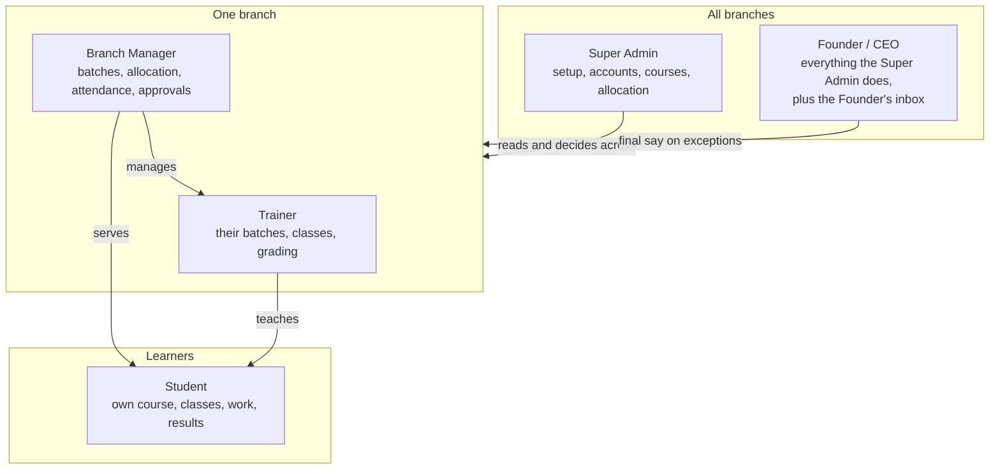

---

## 3. From admission to first class

What happens between a counsellor saving an admission in the CRM and the student sitting in a first class.

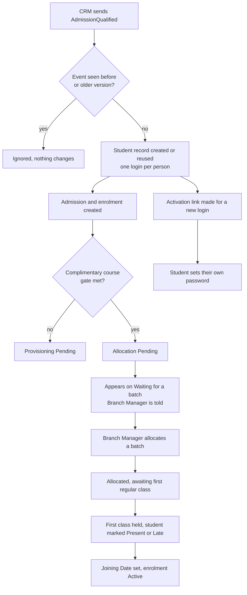

Two things worth knowing: a student signs in with their Student ID (or email), never a mobile number, and the Joining Date
is the day of the first attended class, not the day of allocation.

---

## 4. The life of an enrolment

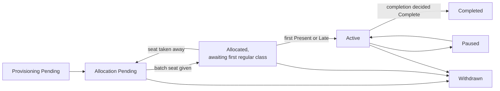

Paused and Withdrawn come from the CRM pausing or cancelling the admission. A completed or withdrawn enrolment keeps its batch history.

---

## 5. Setting up a batch

A batch is a group of students learning one course at one branch on one timetable.

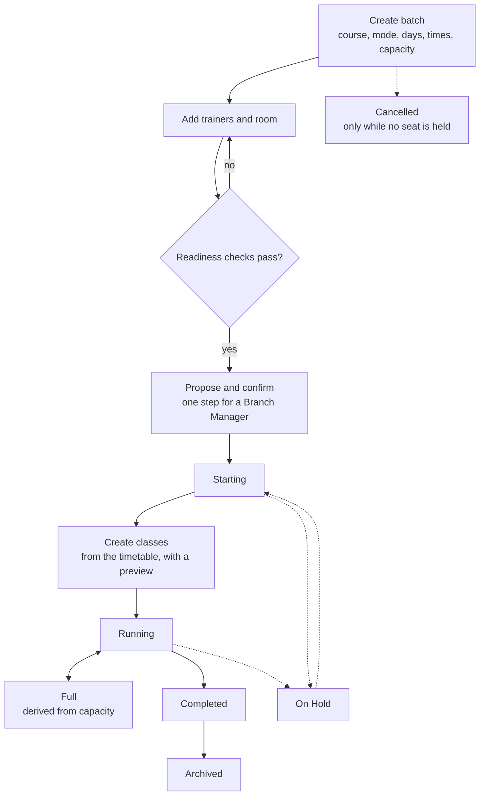

A warning on confirmation needs a written override reason and is audited. After confirmation, changes to start date,
mode or timetable are *material changes*: each student is asked to agree before the change applies.

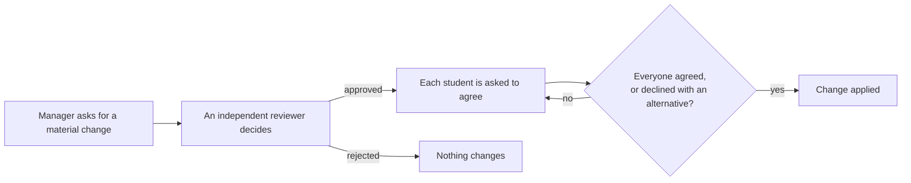

---

## 6. A class day

Every class moves Scheduled → Live → Delivered. The trainer runs it from one guided screen.

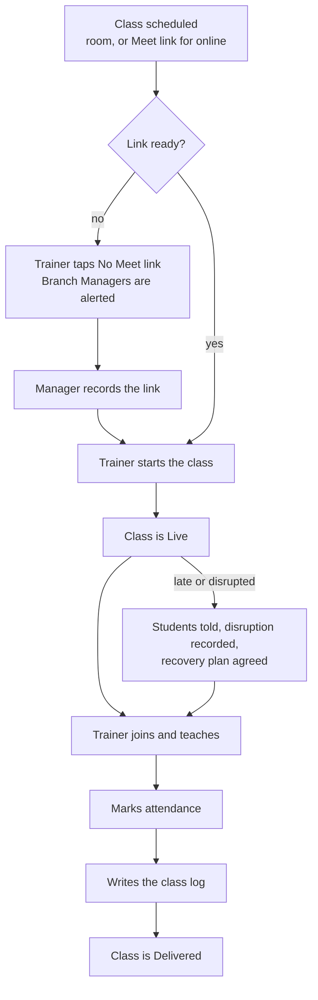

When a class does not happen:

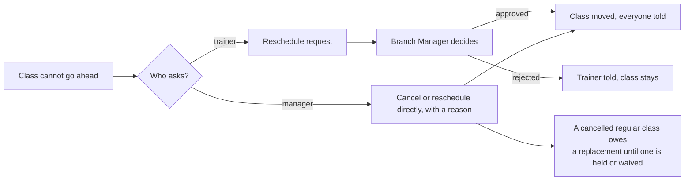

---

## 7. Attendance

An unmarked seat shows as *Not yet marked*, never as a guessed absence.

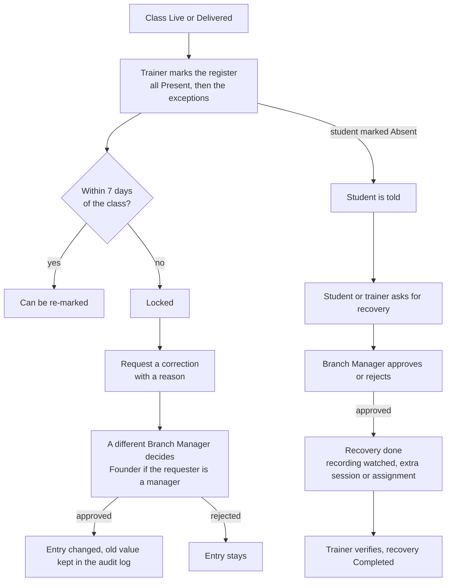

The attendance percentage counts Present and Late over the classes marked while the student held a seat. A recovery is
reported separately.

---

## 8. Content, recordings and how long a student can use them

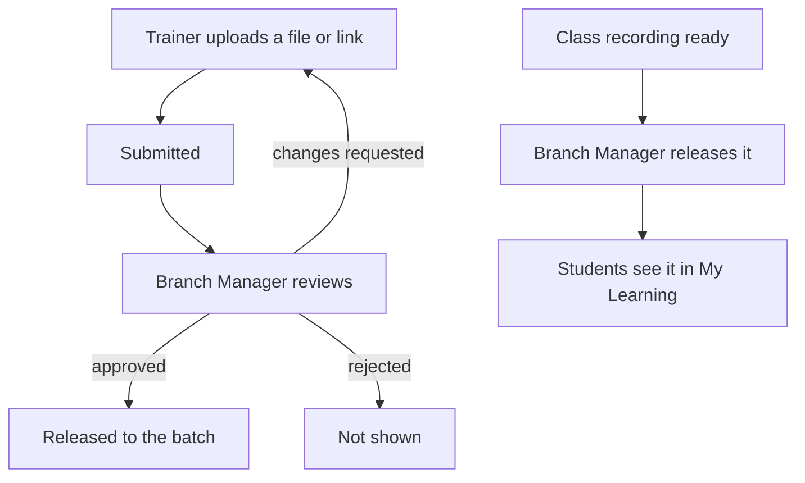

Access to recordings and materials runs from the Joining Date.

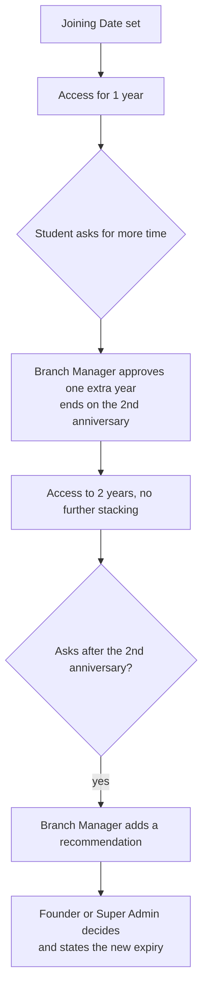

---

## 9. Assignments and tests

```mermaid
flowchart TD
    subgraph Assignment
        A1["Trainer creates and releases"] --> A2["Student submits<br/>file up to 10 MB"]
        A2 --> A3["Trainer starts review"]
        A3 --> A4{"Outcome"}
        A4 -->|"Reviewed with marks"| A5["Provisional result"]
        A4 -->|"Resubmission requested"| A2
    end
    subgraph Test
        T1["Trainer builds from approved questions"] --> T2{"Formal test?"}
        T2 -->|"yes"| T3["Branch Manager approves"]
        T2 -->|"no"| T4["Released"]
        T3 --> T4
        T4 --> T5["Student starts an attempt<br/>timer and autosave"]
        T5 --> T6["Submit, or auto-submit at the deadline"]
        T6 --> T7{"Needs hand grading?"}
        T7 -->|"yes"| T8["Trainer grades"]
        T7 -->|"no"| T9["Scored at once"]
        T8 --> T10["Provisional result"]
    end
```

Test questions are written by trainers and approved by a Branch Manager who did not write them. Approved questions are frozen;
a change makes a new version.

---

## 10. Results

A student sees marks and feedback only once a result is published.

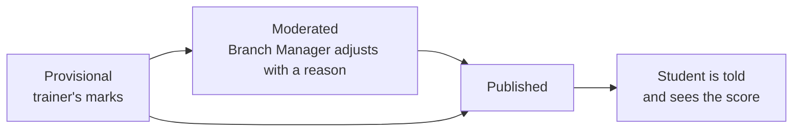

Practice quizzes and mock tests are scored at once and make no result.

---

## 11. Completion and certificates

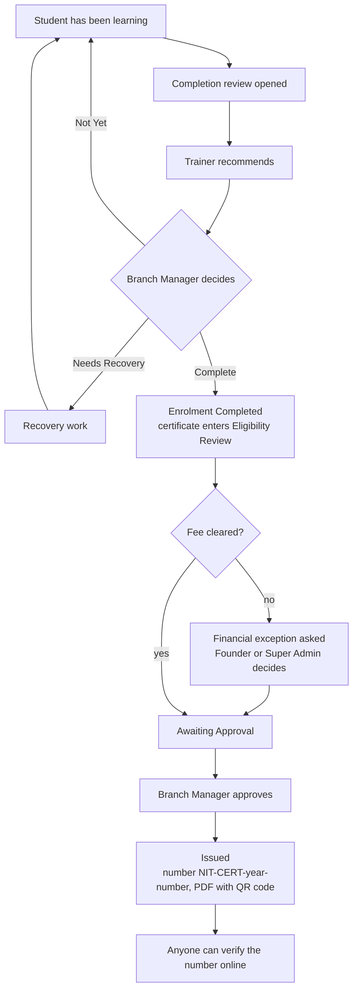

After issue, a certificate can be changed only through a request:

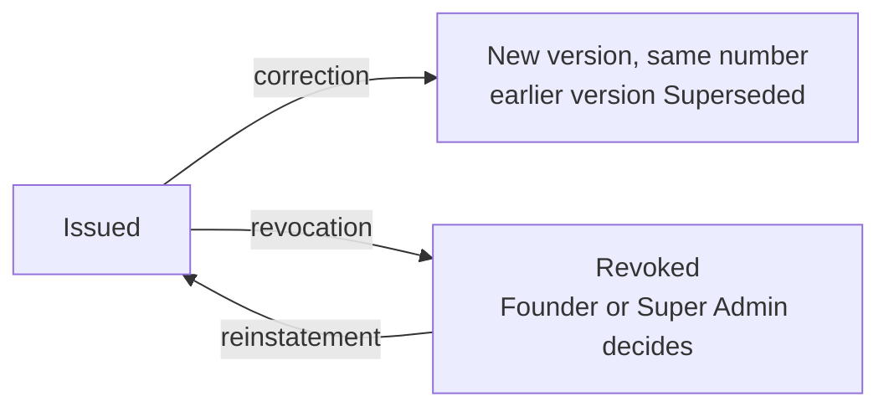

Each issued, superseded or revoked version is sent back to the CRM.

---

## 12. Who decides what

The rule behind most approvals: **the person who asked never decides their own request.**

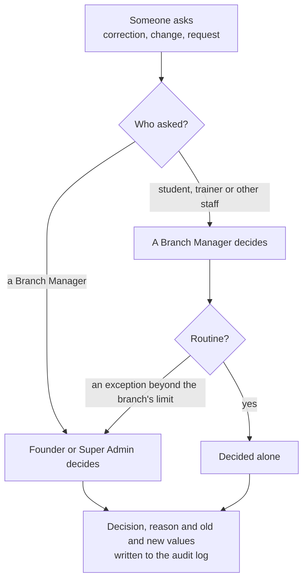

Sensitive decisions (approving or issuing a certificate, deciding corrections) ask the person to sign in again first.

---

## 13. Where to go next

| You want | Open |
|---|---|
| Set the project up and run it | [DEVELOPMENT.md](DEVELOPMENT.md) |
| Every endpoint, role rule and status | [API.md](API.md) |
| The tables, migrations and what the database enforces | [DATABASE.md](DATABASE.md) |
| The CRM contract and its events | [CRM_INTEGRATION.md](CRM_INTEGRATION.md) |
